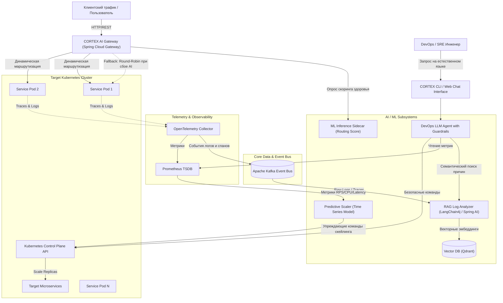

# ТЕХНИЧЕСКОЕ ЗАДАНИЕ И АРХИТЕКТУРНАЯ СПЕЦИФИКАЦИЯ
## Платформа проактивного управления микросервисной инфраструктурой «CORTEX»

* **Проект:** CORTEX (AIOps Platform)
* **Версия документа:** 1.0
* **Статус:** Черновик для согласования и декомпозиции в спринты
* **Целевой стек:** Java 21 / Kotlin, Spring Boot 3, Spring Cloud Gateway, Apache Kafka, Python, Qdrant, Ollama / Cloud LLM API, Kubernetes (k3s), Prometheus, OpenTelemetry, k6.

---

## 1. Назначение и границы системы

### 1.1. Назначение
Платформа **CORTEX** предназначена для интеллектуализации контура управления распределенной микросервисной инфраструктурой, развернутой в кластере Kubernetes. Платформа осуществляет предиктивную динамическую маршрутизацию трафика, упреждающее горизонтальное масштабирование сервисов до фиксации перегрузки, семантический анализ распределённых логов/трейсов (RAG) и полуавтономную диагностику инцидентов через агентный LLM-контур с контролем безопасности (Guardrails).

### 1.2. Роли в разработке и зоны ответственности
1. **Backend-инженер:**
   * Разработка кастомного API-шлюза (Spring Cloud Gateway, Java 21 / Kotlin).
   * Реализация шины данных и продюсеров/консьюмеров Apache Kafka.
   * Интеграция с Kubernetes API (Fabric8 / официальный Java K8s Client).
   * Реализация механизмов отказоустойчивости (Circuit Breaker, Graceful Fallback).
2. **AI / ML-инженер:**
   * Разработка и инференс легковесной ML-модели ранжирования инстансов (ML Routing).
   * Разработка модуля прогнозирования временных рядов метрик нагрузки (Predictor).
   * Построение RAG-пайплайна векторизации логов и трейсов OpenTelemetry в Qdrant.
   * Промпт-инжиниринг LLM-агентов и реализация верификатора безопасности (Guardrails).
3. **DevOps / SRE-инженер:**
   * Развёртывание и поддержка стенда Kubernetes (k3s), Helm-чартов и CI/CD.
   * Настройка стека Observability (Prometheus, Grafana, OpenTelemetry Collector, Jaeger).
   * Разработка профилей нагрузки k6 и сценариев инъекции сбоев (Chaos Engineering).

---

## 2. Архитектура системы и потоки данных



---

## 3. Спецификация компонентов

### 3.1. Интеллектуальный API-шлюз (CORTEX AI Gateway)
* **Технологический стек:** Java 21, Spring Boot 3.3+, Spring Cloud Gateway (WebFlux / Netty).
* **Назначение:** Приём входящего клиентского трафика и интеллектуальное перенаправление запросов на наиболее производительные и стабильные экземпляры сервисов.
* **Ключевые требования:**
  1. **Кастомный `GlobalFilter`**: перехватывает запросы и запрашивает у ML-модуля ранжированный список IP-адресов/портов подов для целевого сервиса.
  2. **Circuit Breaker и Graceful Fallback (Критично!):**
     * При недоступности ML-сервиса или если время ответа ML превышает **10 мс**, шлюз мгновенно переключается на классический алгоритм *Round-Robin* или *Least Connections* без задержки клиентского запроса.
     * Никакой сбой в AI-подсистеме не должен приводить к ошибкам 5xx для клиентов.
  3. **Логирование задержек:** Шлюз собирает точные метрики задержки (TTFB, полный latency) каждого маршрута и асинхронно передает их в шину Kafka.

### 3.2. ML-модуль интеллектуальной маршрутизации (ML Router)
* **Технологический стек:** Python (FastAPI / gRPC) либо Java in-memory ONNX Runtime.
* **Входные данные модели:**
  * Идентификатор пода (`pod_ip`, `pod_id`).
  * Скользящие метрики за последние 30 секунд: средний latency, p95 latency, процент ошибок 5xx, текущая утилизация CPU/Memory, количество активных сетевых соединений.
* **Выходные данные:** Вещественный коэффициент здоровья/производительности $H \in [0.0, 1.0]$ для каждого инстанса.
* **Алгоритм выбора:** Взвешенное случайное распределение (Weighted Random) или выбор инстанса с максимальным score с вероятностью $1 - \epsilon$ (для исследования малонагруженных подов).

### 3.3. Шина событий (Apache Kafka)
Единый транспорт для асинхронной передачи телеметрии между компонентами.

#### Спецификация топиков:
1. `cortex.telemetry.metrics`
   * *Продюсер:* API Gateway, OTel Collector.
   * *Консьюмер:* Predictor Service.
   * *Пейлоад:*
     ```json
     {
       "timestamp": "2026-11-01T13:45:00.123Z",
       "service": "order-service",
       "pod_id": "order-service-7f8d8b88-x9kz2",
       "rps": 142.5,
       "latency_p95_ms": 38.2,
       "error_rate": 0.005,
       "cpu_utilization": 0.68
     }
     ```
2. `cortex.telemetry.spans`
   * *Продюсер:* OpenTelemetry Collector.
   * *Консьюмер:* RAG Vector Ingestion Service.
   * *Пейлоад:* TraceID, SpanID, ParentSpanID, ServiceName, DurationMs, StatusCode, Attributes, ErrorMessage.
3. `cortex.alerts.system`
   * *Продюсер:* Prometheus Alertmanager / Circuit Breaker.
   * *Консьюмер:* LLM DevOps Agent.

### 3.4. Модуль предиктивного скейлинга (Predictor Service)
* **Технологический стек:** Python (Prophet / LightGBM / LSTM / scikit-learn) + Spring Boot Worker (опционально для вызова K8s API).
* **Принцип работы:**
  1. Модуль непрерывно считывает исторические показатели входящего трафика (RPS) и утилизации ресурсов за окно $T_{window} = 15$ минут.
  2. Выполняет прогноз нагрузки на горизонт упреждения $T_{future} = 2..5$ минут.
  3. Если прогнозируемый RPS превышает порог производительности текущего числа реплик $N_{current}$, формируется команда на упреждающее масштабирование:
     $$N_{target} = \lceil \frac{RPS_{predicted}}{RPS_{capacity\_per\_pod}} \rceil$$
  4. Модуль отправляет патч через Kubernetes API (`PATCH /apis/apps/v1/namespaces/{ns}/deployments/{dep}/scale`), опережая стандартный HPA на время старта и прогрева пода (обычно 40–90 секунд).

### 3.5. RAG-подсистема анализа распределённых логов и трейсов
* **Технологический стек:** Qdrant (векторная база данных), LangChain4j / Spring AI, Python / Java.
* **Векторное хранилище:**
  * Коллекция: `telemetry_traces_and_logs`.
  * Эмбеддинг-модель: локальная модель эмбеддингов (например, `bge-m3` или `all-MiniLM-L6-v2` через Ollama/TEI).
  * Payload: `trace_id`, `service`, `timestamp`, `log_level`, `exception_class`, `stack_trace`, `span_context`.
* **Сценарий работы (Root Cause Analysis):**
  1. При возникновении всплеска ошибок или запросе инженера («Почему вырос latency в сервисе оформления заказа?») система формирует семантический запрос.
  2. В Qdrant выполняется гибридный поиск (векторная близость + фильтрация по времени и сервису).
  3. Найденные релевантные трейсы и фрагменты логов упаковываются в промпт для LLM.
  4. LLM формирует структурированный ответ с указанием первопричины сбоя, затронутых сервисов и конкретного `trace_id`.

### 3.6. LLM DevOps-агенты и контур безопасности (Guardrails)
* **Технологический стек:** Spring AI / LangChain4j, локальная LLM (Llama 3 / Mistral / Qwen 2.5 через Ollama) или OpenAI/Anthropic API.
* **Доступные инструменты (Agent Tools):**
  * `query_prometheus(query)` — чтение метрик.
  * `get_kubernetes_pods(namespace, label)` — чтение состояния подов.
  * `analyze_trace(trace_id)` — вызов RAG-модуля по конкретному трейсу.
  * `scale_deployment(deployment, replicas)` — мутирующая операция.
  * `restart_pod(pod_id)` — мутирующая операция.
* **Политика безопасности (Guardrails):**
  > [!IMPORTANT]
  > Все операции делятся на два класса:
  > * **Read-only (чтение):** выполняются агентом автономно.
  > * **Mutating (изменение):** генерация плана действий и запрос обязательного подтверждения у оператора (Human-in-the-Loop) через интерфейс. Запрещены прямые команды на удаление пространств имён, баз данных или постоянных томов (PV/PVC).

---

## 4. Стенд тестирования и демонстрации (Demo-Bench)

Для подтверждения эффективности системы разрабатывается синтетический стенд:
1. **Тестовое микросервисное приложение:**
   * `gateway-service` — входная точка.
   * `order-service` — сервис управления заказами.
   * `payment-service` — симуляция обработки транзакций.
   * `inventory-service` — складской учет (эмулирует работу с БД).
2. **Генераторы нагрузки (k6):**
   * Профиль 1: Стационарный трафик (baseline).
   * Профиль 2: Резкий всплеск (Step-load / Spike: скачок с 50 до 1000 RPS за 10 секунд).
   * Профиль 3: Волнообразная суточная нагрузка (синусоида).
3. **Моделирование сбоев (Chaos Engineering / Chaos Mesh):**
   * Сценарий «Скрытая деградация»: один из трёх подов `order-service` искусственно задерживает ответы на 1500 мс.
   * Сценарий «Отказ зависимости»: база данных `inventory-service` начинает отдавать 500-е ошибки на 30% запросов.

---

## 5. Декомпозиция задач для первого семестра (Спринты для YouGile)

Дорожная карта 1-го семестра разбита на 4 спринта (по 2–3 недели каждый):

### Спринт 1: Инфраструктурный фундамент и полигон (DevOps + Backend)
* **DevOps:**
  * [ ] Развернуть локальный кластер Kubernetes (`k3s`).
  * [ ] Настроить Helm-чарты: Apache Kafka, Prometheus, Grafana, OpenTelemetry Collector.
  * [ ] Настроить GitHub Actions CI для сборки Docker-образов.
* **Backend:**
  * [ ] Создать каркас микросервисного демо-приложения (`order-service`, `payment-service`) на Spring Boot 3.
  * [ ] Настроить экспорт трейсов и логов через OpenTelemetry Java Agent.
* **ML:**
  * [ ] Развернуть инстанс векторной БД Qdrant.
  * [ ] Настроить тестовую интеграцию с Ollama (запуск локальных моделей).

### Спринт 2: Ядро API-шлюза и шина данных (Backend + DevOps)
* **Backend:**
  * [ ] Разработать базовый сервис `cortex-gateway` на Spring Cloud Gateway.
  * [ ] Реализовать фильтр сбора и отправки метрик задержек в топик Kafka `cortex.telemetry.metrics`.
  * [ ] Реализовать Circuit Breaker на Resilience4j для защиты от сбоев внешних сервисов.
* **DevOps:**
  * [ ] Написать базовый тестовый скрипт k6 для генерации постоянного потока запросов на шлюз.
  * [ ] Создать Grafana Dashboard для отображения latency и RPS в реальном времени.
* **ML:**
  * [ ] Спроектировать формат данных датасета для обучения модели оценки здоровья узлов.

### Спринт 3: Первый ML-контур маршрутизации (ML + Backend)
* **ML:**
  * [ ] Обучить базовую модель скоринга инстансов (на основе синтетических данных метрик задержек и ошибок).
  * [ ] Разработать легковесный API-сервис инференса скоринга (gRPC или REST с временем ответа < 5 мс).
* **Backend:**
  * [ ] Интегрировать вызов ML-инференса в кастомный фильтр маршрутизации `cortex-gateway`.
  * [ ] Реализовать механизм Graceful Fallback на Round-Robin при таймауте ответа ML более 10 мс.
* **DevOps:**
  * [ ] Подготовить сценарий Chaos Engineering с искусственной задержкой на одном из подов.

### Спринт 4: Сравнительные тесты и Промежуточное Демо 1 (Вся команда)
* **DevOps + Backend + ML:**
  * [ ] Провести нагрузочный прогон: сравнить распределение задержек (p95, p99) стандартного Round-Robin против CORTEX ML-маршрутизатора в условиях деградации одного пода.
  * [ ] Зафиксировать результаты и графики в Grafana (демонстрация перенаправления трафика на «здоровые» узлы).
  * [ ] Подготовить отчет и провести защитный показ первого семестра (Демо 1).

---

## 6. Контрольные критерии успешности (KPIs)
1. **Задержка ML-инференса маршрутизации:** $\le 8$ мс на запрос.
2. **Надежность шлюза при отказе AI:** 0% потерь запросов (мгновенный откат на fallback за время $\le 2$ мс).
3. **Эффективность ML-маршрутизации (Демо 1):** снижение p95 latency минимум на 15% в условиях частично деградировавшего узла.
